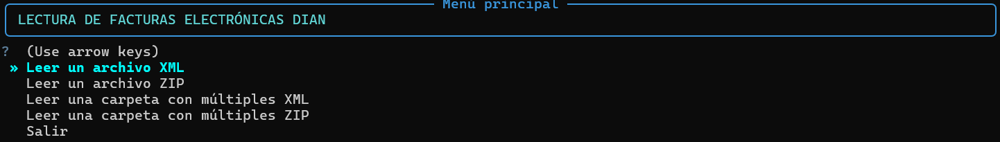

<h1 align="center"">Lectura Información Factura Electrónica - DIAN</h1>

<p align="center">
  
  _3.14-FFFF00?style=for-the-badge&logo=Python&logoColor=white" alt="alt text">
</p>

---

Este proyecto es una simple aplicación de consola que permite leer facturas electrónicas de la DIAN en formato XML y extraer información relevante como información del proveedor, valor total, o UUID. La aplicación permite visualizar la información en consola o exportar los datos a archivos .xlsx para su posterior análisis.

---

## ✨ Features

- 🎨 **Interfaz en terminal:** Salida en terminal formateada con barra de progreso y esquemas de color para visualizar información.
- 🛠️ **Orientado al desarrollo:** Desarrollado con `uv` y `rich`.

---

## 1. Uso

El proyecto es gestionado con `uv`. Clona el repositorio y sincroniza las dependencias:

```bash
git clone https://github.com/fabianperdomolaguna/Lectura_Factura_Electronica_DIAN.git
cd Lectura_Factura_Electronica_DIAN
uv sync
```

Para usar este proyecto escribe lo siguiente en una consola:

```bash
uv run src/main.py
```

<h1 align="center">
  
</h1>
